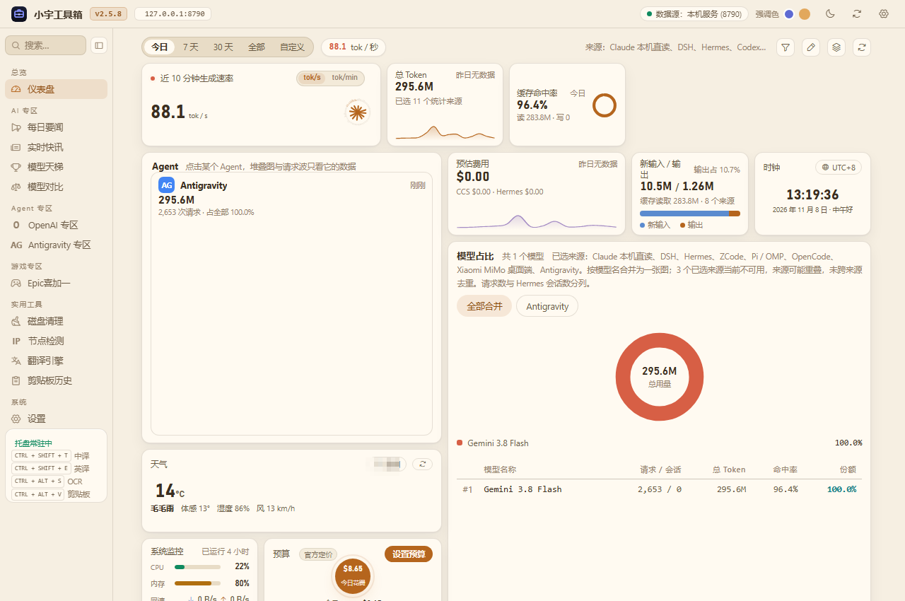
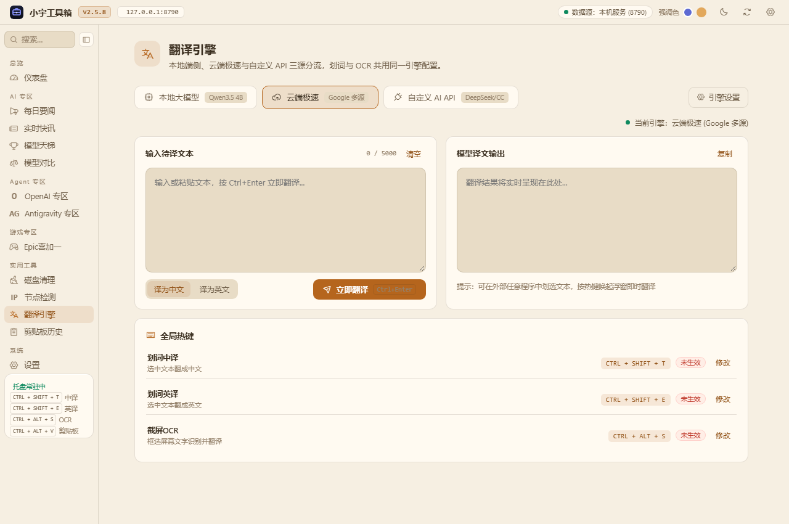
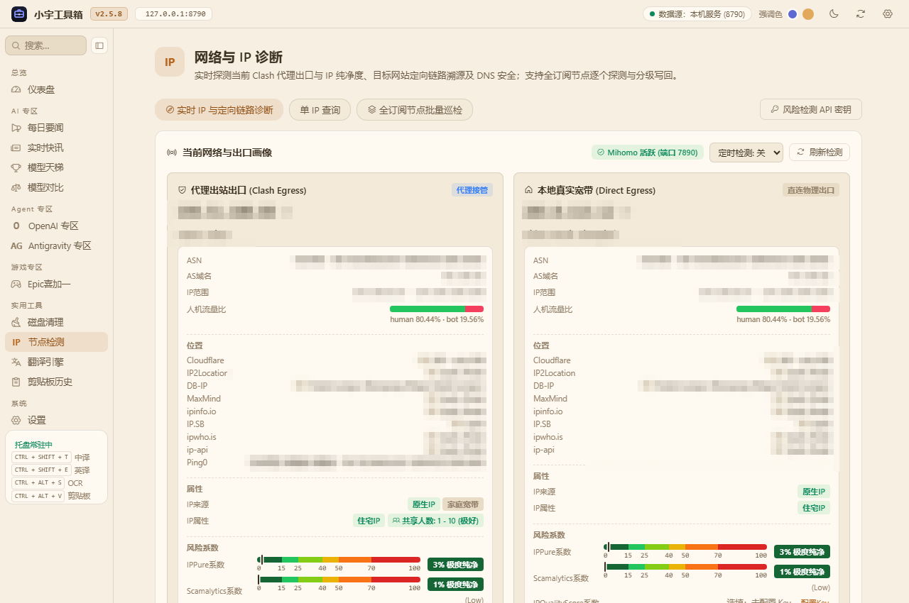
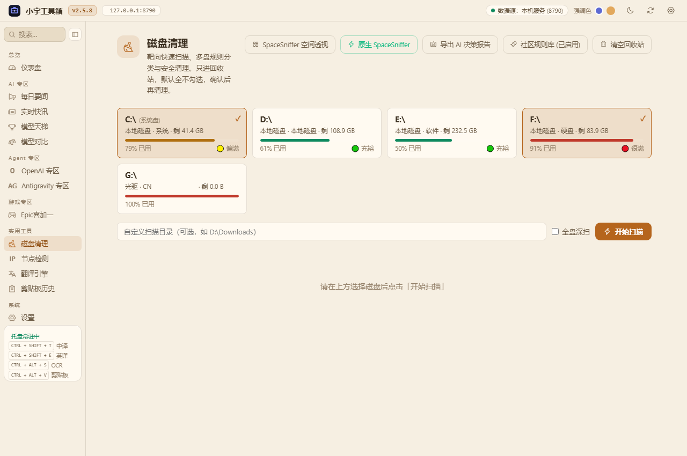
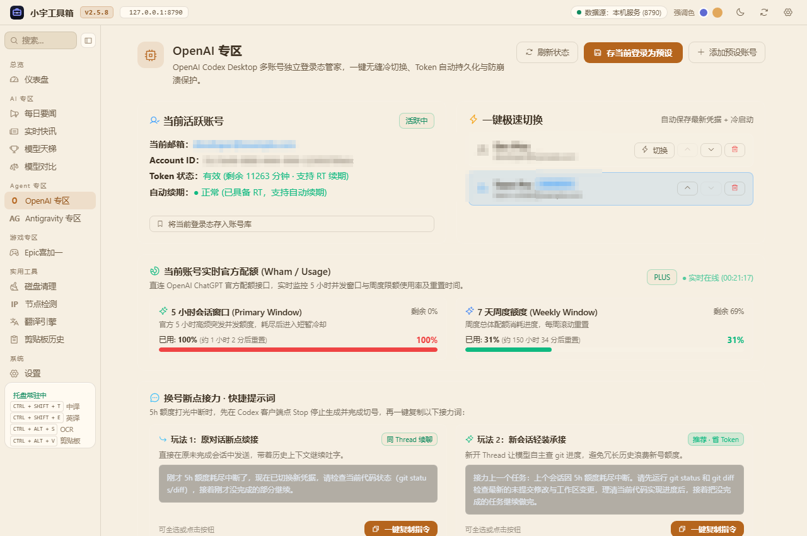
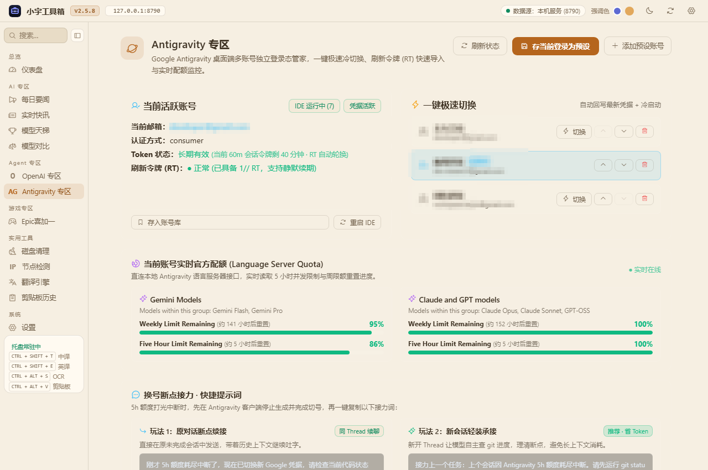
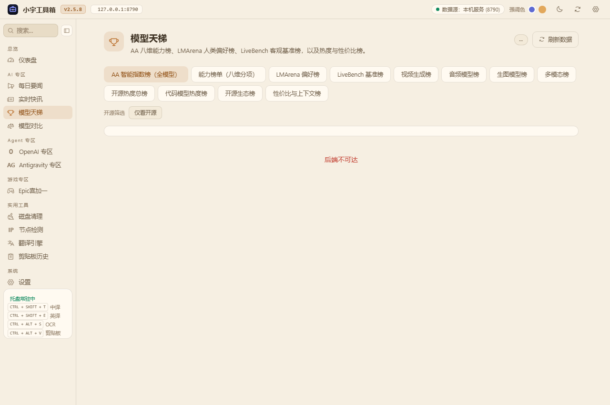
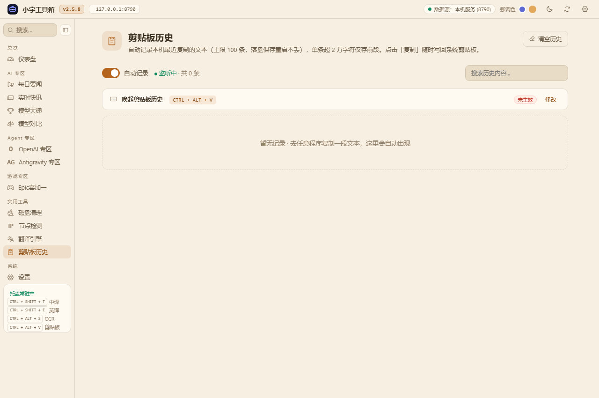
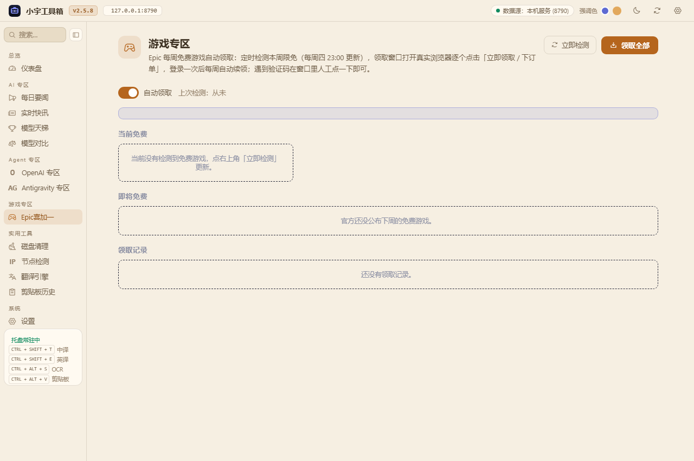

# 小宇工具箱开源版（XiaoyuToolbox-OSS）

[](https://github.com/TerryYu12/XiaoyuToolbox-OSS/releases/latest)
[](https://github.com/TerryYu12/XiaoyuToolbox-OSS/actions/workflows/build-release.yml)
[](LICENSE)

Windows 桌面轻量实用工具合集：划词翻译、离线 OCR、剪贴板历史、Winapp2 智能磁盘清理、Clash 节点测速与 IP 质量审计、AI 权威天梯榜单、OpenAI 与 Antigravity 桌面端账号切换管家、Epic 每周喜加一。

基于 **pywebview（WebView2）原生窗口 + 本地 8790 服务 + 系统托盘常驻** 构建。全部配置与运行缓存落在本地，不向系统目录写入无用残留，绿色便携。

---

## 目录

- [功能全景与截图](#功能全景与截图)
  - [1. 仪表盘与 Token 监控](#1-仪表盘与-token-监控)
  - [2. 划词翻译与离线 OCR](#2-划词翻译与离线-ocr)
  - [3. 网络与 Clash 节点检测](#3-网络与-clash-节点检测)
  - [4. 智能磁盘清理与空间透视](#4-智能磁盘清理与空间透视)
  - [5. AI Coding Agent 账号管家](#5-ai-coding-agent-账号管家)
  - [6. AI 资讯与权威模型天梯](#6-ai-资讯与权威模型天梯)
  - [7. 剪贴板历史与 Epic 喜加一](#7-剪贴板历史与-epic-喜加一)
- [全局默认快捷键](#全局默认快捷键)
- [运行环境要求](#运行环境要求)
- [快速上手](#快速上手)
  - [直接下载（推荐）](#直接下载推荐)
  - [从源码运行](#从源码运行)
  - [打包单文件 Exe](#打包单文件-exe)
- [运行数据与便携性规范](#运行数据与便携性规范)
- [节点检测使用说明](#节点检测使用说明)
- [开源依赖与致谢](#开源依赖与致谢)
- [许可证](#许可证)

---

## 功能全景与截图

### 1. 仪表盘与 Token 监控



- **本地 Agent 记账全景**：统计本地 Codex Desktop、Antigravity 等开发工具的会话消耗，展示输入、输出、缓存读取 Token 量与成本核算。
- **实时生成速率**：近 10 分钟生成速率图表，支持 `tok/s` 与 `tok/min` 切换。
- **系统状态监视**：实时掌握本机 CPU、内存占用与网络 IO 流量。

---

### 2. 划词翻译与离线 OCR



- **全局热键划词即译**：任意软件中选中文本，按下快捷键即唤起贴边自适应结果弹窗，支持自动语种识别、语音朗读与一键复制。
- **多引擎分流与故障接力**：
  - **云端免密极速**：Google、百度、MyMemory 多通道自动接力。
  - **自定义 AI 接口**：可配置任意兼容 OpenAI 规范的 API 端点（OpenAI、DeepSeek、SiliconFlow 等），自由填入 API Key 与目标模型。
- **离线原生 OCR**：基于 Windows 原生运行时 `Windows.Media.Ocr`（WinRT 投影），纯本地图片文字提取，不上传任何图像至云端，隐私无忧。

---

### 3. 网络与 Clash 节点检测



- **专为 Clash Verge Rev 深度适配**：自动嗅探正在运行的内核进程及安装配置目录，免去手动查找配置路径的繁琐。
- **隔离实例安全测速**：在沙盒临时端口启动独立内核实例逐节点探测，不干扰主代理的日常网络连接。
- **出口 IP 纯净度与质量透视**：
  - 多源情报（IPQS、Ping0、ipapi.is、Cloudflare）多维度交叉审计。
  - 实时评估欺诈度评分（Fraud Score）、机房/原生住宅属性画像、人机流量比与流媒体解锁状态。
- **分级安全写回**：支持将优质节点分级写回 `Merge.yaml`，写回前强制执行时间戳备份与 `mihomo -t` 内核语法校验。

---

### 4. 智能磁盘清理与空间透视



- **社区规则驱动**：基于 Winapp2 社区 3000+ 条清理规则，靶向扫描系统临时文件、各软件应用缓存与无用残留。
- **SpaceSniffer 空间透视**：内置 Treemap 矩形树状图引擎，直观可视化大文件与空间占用分布。
- **安全防误删保障**：扫描结果按风险分级（安全 / 需注意 / 谨慎），默认全不勾选；文件清理调用 Windows 原生回收站（`send2trash`），随时可撤销还原。

---

### 5. AI Coding Agent 账号管家

#### OpenAI 专区（Codex Desktop）



- **多账号独立会话隔离**：解决官方客户端无法多账号快速切换的痛点，会话与登录凭据独立保管。
- **一键极速冷切换**：安全终止进程后写入目标凭据并静默拉起，内置崩溃与冷重启保护。
- **官方配额直连透视**：实时读取 5 小时高频并发窗口与 7 天周额度消耗进度；内置换号断点轻装接力提示词，一键复制发送给模型。

#### Antigravity 专区（Google Antigravity）



- **多 Google 账号/RT 快速导入**：集中管理多个 Google 账号的登录态与 Refresh Token，支持免登录冷切。
- **语言服务器配额监控**：直连本地语言服务器端点，实时监控 Gemini 系列与 Claude/GPT 模型的 5 小时突发并发与周重置进度。

---

### 6. AI 资讯与权威模型天梯



- **全球权威天梯榜单**：聚合 Artificial Analysis 智能指数榜、LMSYS Chatbot Arena 人类偏好榜、LiveBench 客观基准等权威榜单，涵盖代码、开源、性价比等多维度筛选。
- **每日要闻与快讯聚合**：自动追踪全球 AI 前沿动态与多源 RSS 资讯。

---

### 7. 剪贴板历史与 Epic 喜加一

| 剪贴板历史 | Epic 每周喜加一 |
| :---: | :---: |
|  |  |

- **剪贴板历史**：轻量后台记录最近 100 条复制文本，支持全局热键唤起、搜索过滤与一键快速写回。
- **Epic 每周喜加一**：自动探测 Epic 官方每周限免游戏促销，借助 WebView2 窗口半自动快速安全领取。

---

## 全局默认快捷键

可在主界面「设置」或「翻译引擎」页面中按个人习惯自由修改：

| 功能 | 默认快捷键 | 说明 |
|---|---|---|
| **划词中译** | `Ctrl + Shift + T` | 选中文本后按下，即刻翻译为中文 |
| **划词英译** | `Ctrl + Shift + E` | 选中文本后按下，即刻翻译为英文 |
| **截屏 OCR 翻译** | `Ctrl + Alt + S` | 自由拉框截取屏幕区域文字并翻译 |
| **唤起剪贴板历史** | `Alt + Win + V` | 快速弹出历史剪贴板悬浮窗 |

---

## 运行环境要求

- **操作系统**：Windows 10 19045+ / Windows 11（依赖系统内置 WebView2 运行时）
- **Python 环境**：Python 3.11（推荐使用 [uv](https://github.com/astral-sh/uv) 管理的 standalone Python）
- **Node.js**（可选）：仅前端开发及 `node --check` 语法校验时需要，日常运行无需安装

---

## 快速上手

### 直接下载（推荐）

前往 [GitHub Releases 页面](https://github.com/TerryYu12/XiaoyuToolbox-OSS/releases/latest) 下载最新发布的绿色免安装压缩包：

- 下载 `XiaoyuToolbox-OSS-v*-win-x64.zip`；
- 解压到任意你喜欢的目录（如 `D:\Program\XiaoyuToolbox`）；
- 双击运行 `XiaoyuToolbox-OSS.exe` 即可（无需安装任何 Python 运行库）。

### 从源码运行

```bat
git clone https://github.com/TerryYu12/XiaoyuToolbox-OSS.git
cd XiaoyuToolbox-OSS

:: 创建并激活虚拟环境
python -m venv .venv
.venv\Scripts\pip install -r requirements.txt

:: 运行主程序
.venv\Scripts\python toolbox_main.py
```

启动后托盘常驻，WebUI 与本地 API 驻留在 `http://127.0.0.1:8790`。

### 打包单文件 Exe

打包脚本基于 PyInstaller，编译为单文件绿色免安装可执行程序：

```bat
:: 设置 tcl/tk 路径（避免 Python standalone 布局下漏收 tkinter）
set TCL_LIBRARY=<你的 Python 目录>\tcl\tcl8.6
set TK_LIBRARY=<你的 Python 目录>\tcl\tk8.6

:: 执行打包
.venv\Scripts\python -m PyInstaller XiaoyuToolbox-OSS.spec --noconfirm
```

构建完成后产物位于 `dist\XiaoyuToolbox-OSS.exe`，大小约为 45MB，双击即可直接运行。

---

## 运行数据与便携性规范

- **单目录便携**：所有本地数据库、缓存与运行配置文件均保存在 exe 同目录下，解压即用，随身携带不丢失。
- **外观个性化**：主题与卡片布局保存在 `%LOCALAPPDATA%\XiaoyuToolbox\appearance.json`。
- **数据保密**：用户配置的 API Key（如翻译服务密钥）仅存于本机 `config.json`，严禁上传云端。

---

## 节点检测使用说明

- **内核寻径机制**：依次探测「正在运行的 `verge-mihomo.exe` 进程 → Verge UI 安装目录内核副本 → 常见默认安装路径」。
- **权限与兜底**：使用服务模式（clash-verge-service）时，其内核目录受 Windows ACL 保护不可读，程序会自动跳过；若未能自动检测到，可在界面设置中手动指定内核路径。
- **安全写回**：写回配置前会自动生成带时间戳的配置备份，并通过 `mihomo -t` 命令进行内核配置语法有效性校验，杜绝导致代理客户端崩溃的非法配置。

---

## 开源依赖与致谢

| 开源项目 / 库 | 用途与集成形态 |
|---|---|
| [pywebview](https://github.com/r0x0r/pywebview) | 原生桌面窗口宿主容器（基于 WebView2） |
| [PyInstaller](https://pyinstaller.org) | 单文件便携版 exe 打包构建 |
| [psutil](https://github.com/giampaolo/psutil) | 系统资源监控、进程探测与常驻守护 |
| [PyYAML](https://pyyaml.org) | Clash / Mihomo 配置文件的解析与导出 |
| [Pillow](https://python-pillow.org) | 屏幕截图、图标与图像预处理 |
| [send2trash](https://github.com/arsenetar/send2trash) | 磁盘清理文件安全删除（送入系统回收站） |
| [winsdk / pywinrt](https://github.com/doloopwhile/pywinrt) | 接入 Windows.Media.Ocr 原生离线 OCR 引擎 |
| [winapp2](https://github.com/Mosca1337/Winapp2) | 社区驱动的垃圾清理规则库（按需下载） |
| [Clash Verge Rev](https://github.com/clash-verge-rev/clash-verge-rev) | 节点检测模块的适配目标 |
| [LiveBench](https://github.com/LiveBench/new-livebench) | 权威客观评测基准榜单数据源 |
| [STranslate](https://github.com/STranslate/STranslate) | 划词翻译弹窗交互形态与设计借鉴 |
| [CopyTranslator](https://github.com/CopyTranslator/CopyTranslator) | 剪贴板监听翻译设计模式借鉴 |

完整 Python 依赖版本锁定详见 [requirements.txt](requirements.txt)。

---

## 许可证

本项目基于 [MIT 许可证](LICENSE) 开源。

© 2026 TerryYu12
